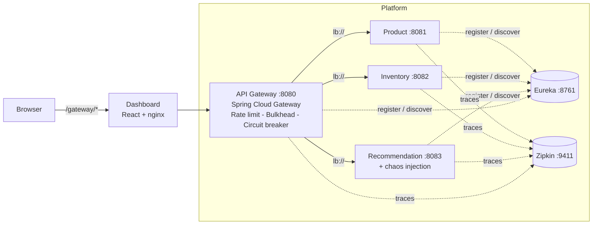

# CircuitBreaker Platform

**A cloud-native e-commerce backend that stays up when its dependencies fall over.**
Spring Cloud Gateway + Resilience4j protect three Spring Boot microservices behind Eureka service
discovery, with Zipkin tracing and a live React dashboard where you can *break the system on purpose* and
watch it heal itself.

     

> **Demo:** add your GIF here -> `` (see `docs/images/README.md`)

---

## The problem

In a microservices system, one slow dependency can take everything down. If the Recommendation service
starts timing out on Black Friday, every request waiting on it holds a connection and a thread, until the
gateway has none left for Checkout and Search either. This is a **cascading failure**.

## The solution

All traffic enters through an API gateway that applies layered resilience patterns per route:

| Pattern | Purpose | Implementation |
|---|---|---|
| **Rate limiting** | Stop scraping / bursts from one client (HTTP 429) | Custom per-client, per-route **token bucket** gateway filter |
| **Bulkhead** | Cap concurrent calls so one slow route cannot absorb all capacity (HTTP 503) | Resilience4j `Bulkhead` wrapped in a gateway filter |
| **Time limiter** | Never wait more than 3 s for a backend | Resilience4j `TimeLimiter` |
| **Circuit breaker** | After 50 % failures in a 6-call window, fail fast for 10 s, then probe (HALF_OPEN) and self-heal | Resilience4j `CircuitBreaker` |
| **Retry** | Absorb transient 502/503/504 on idempotent GETs | Gateway `Retry` filter (inside the breaker, so the breaker counts one outcome per client request) |
| **Fallback** | Degrade gracefully instead of erroring | Recommendations -> static "Top Sellers" (200); Product/Inventory -> honest 503 |

Filter order for the Recommendation route: `RateLimit -> Bulkhead -> CircuitBreaker(+TimeLimiter) -> Retry`.

## Architecture



| Module | Port | Responsibility |
|---|---|---|
| `eureka-server` | 8761 | Service registry |
| `gateway-service` | 8080 | Routing, load balancing, all resilience patterns, `/resilience/status` feed for the UI |
| `product-service` | 8081 | Product catalogue CRUD (H2, validation, RFC 7807 errors) |
| `inventory-service` | 8082 | Stock levels + atomic `reserve` with optimistic locking (409 on insufficient stock) |
| `recommendation-service` | 8083 | Recommendations + fault-injection endpoint (the deliberately flaky dependency) |
| `dashboard` | 5173 dev / 3000 Docker | Live monitoring + chaos controls |

## Quick start

### Prerequisites

| Tool | Version | Needed for |
|---|---|---|
| JDK | 17+ | running the services (Option B) |
| Node.js | 18+ | the dashboard (Option B) |
| Docker Desktop | any recent | Option A only |

Maven is bundled (`mvnw`). The first build downloads dependencies, so allow a few minutes and an internet connection.

### Option A - Docker (also gives you Zipkin tracing)

```bash
docker compose up --build
```

Dashboard: **http://localhost:3000** | Zipkin: http://localhost:9411

### Option B - without Docker

```powershell
# Windows PowerShell
powershell -ExecutionPolicy Bypass -File .\scripts\run-local.ps1
```
```bash
# Linux / macOS / Git Bash
scripts/run-local.sh
```

The script stops any previous run, builds, starts Eureka, the three services, the gateway and the dashboard, then prints the URLs. **Wait ~30 s** for the services to register with Eureka. Dashboard: **http://localhost:5173**.

> The script frees ports 8761, 8080-8083 and 5173 - anything listening there is stopped.

Stop everything: `.\scripts\run-local.ps1 stop` (or `scripts/run-local.sh stop`).

### Verify the whole system in one command

```powershell
.\scripts\smoke-test.ps1          # Linux/macOS: scripts/smoke-test.sh
```

~20 checks across routing, validation, stock rules, rate limiting and a full breaker cycle (CLOSED -> OPEN -> HALF_OPEN -> CLOSED). Prints `ALL CHECKS PASSED` when healthy. Add `-SkipChaos` for a 10-second version.

## What the dashboard shows

| Panel | Audience question it answers |
|---|---|
| **Customer view: storefront** | "What does the shopper experience?" Products + stock load from two services; the *Recommended for you* strip turns amber and switches to *Top sellers (FALLBACK)* when the service fails |
| **Ops view: live architecture** | "How is the system built, and what is failing?" Browser -> Gateway -> Product / Inventory / Recommendation, Eureka registry, fallback box; edge colour = breaker state (green / red / amber), animated while traffic flows |
| **Microservices + Circuit breakers** | health per service, failure rate vs threshold, calls short-circuited |
| **Chaos control + Load test** | break the service on demand; fire a 40-request burst |
| **Request log, latency chart, timeline** | which component served each request, how long it took, and when each breaker changed state |

**Presenting tip:** keep the storefront and the architecture diagram visible together, start Auto traffic, then inject latency. The audience sees the diagram edge turn red and the storefront degrade, while the product grid keeps working.

## Demo (about 2 minutes)

Open the dashboard and follow the timings:

| Step | Action | Wait | You should see |
|---|---|---|---|
| 1 | Open the page | - | 3 services **UP**, 3 breakers green **CLOSED** |
| 2 | Tick **Auto traffic** | 30 s | green dots near 0 ms |
| 3 | Click **Inject latency (4s)** | ~15 s | dots jump to ~3000 ms and turn amber; after **3** slow calls the Recommendation breaker turns red **OPEN** |
| 4 | Do nothing | 5 s | amber dots but near 0 ms: fallbacks are instant; Product/Inventory stay green |
| 5 | Untick Auto traffic, click **Heal service** | 11 s | breaker turns amber **HALF-OPEN** |
| 6 | Tick Auto traffic again | 5 s | breaker returns to green **CLOSED**; timeline shows `CLOSED -> OPEN -> HALF_OPEN -> CLOSED` |
| 7 | Click **Send burst (40 requests)** | instant | the **429** counter rises (rate limiter) |
| 8 | Inject latency, then burst | ~5 s | the **bulkhead** counter rises (max 5 concurrent) |
| 9 | Click **Inject errors (500)**, then **Heal service** | 15 s | breaker opens on errors too, then recovers |

Always finish with **Heal service**. Terminal version: `scripts/chaos-demo.sh`.

**Taking screenshots:** zoom the browser to ~67 % (`Ctrl` and `-`) so the storefront and diagram fit on one screen. The strongest shot is the *top of the page while the breaker is OPEN* (amber storefront strip + red diagram edge).

## Measured behaviour

Run against the real gateway with mock backends (3 s time limit, 6-call window, 4-call minimum, 50 % threshold):

| Scenario | Result |
|---|---|
| Backend answers in 4 s | 3 timeouts at ~3.02 s each -> breaker opens at 60 % failure rate |
| Breaker OPEN | fallback served in **~7-10 ms** (vs 3 s waiting) |
| Other routes while OPEN | `/products`, `/inventory` -> 200 in ~14 ms, gateway `/actuator/health` stays `UP` |
| Recovery | `CLOSED -> OPEN -> HALF_OPEN -> CLOSED` observed automatically after the 10 s wait |
| Bulkhead (max 5), 9 concurrent slow calls | 5 admitted, 4 rejected with 503 + `X-Bulkhead-Rejected` |
| Rate limiter (burst 20, 10/s), 40 rapid calls | excess rejected with 429 + `Retry-After` |
| Backend process killed | retries then fallback in ~170 ms, instant once OPEN; `POST` to a dead service returns a clean 503 JSON |

## API reference (via the gateway, port 8080)

| Method & path | Notes |
|---|---|
| `GET/POST /products`, `GET/PUT/DELETE /products/{id}` | `?category=` filter; validated; 404/400 as problem+json |
| `GET/POST /inventory`, `GET/PUT/DELETE /inventory/{productId}` | |
| `POST /inventory/{productId}/reserve?quantity=n` | atomic decrement; 409 if not enough stock |
| `GET /recommendations`, `GET /recommendations/{productId}` | response has `source` and `degraded` so clients can tell live from fallback; `X-Fallback: true` header on fallbacks |
| `GET /recommendations/slow`, `/recommendations/fail` | manual test hooks (always slow / always 500) |
| `GET/POST /admin/recommendation/chaos` | `{"mode":"NONE\|LATENCY\|ERROR","latencyMs":4000}` - bypasses the breaker so you can heal while OPEN |
| `GET /resilience/status` | breaker state + metrics, bulkheads, service health, transition timeline |
| `GET /` | JSON landing page describing the gateway |
| `GET /actuator/{health,metrics,prometheus,circuitbreakers,circuitbreakerevents,gateway}` | |

## Key design decisions

- **Custom rate limiter over Resilience4j's:** Resilience4j limits are global per instance; abuse protection needs one bucket *per client*. Buckets are per route, idle ones are evicted, and `X-Forwarded-For` is only trusted when explicitly enabled (it is spoofable).
- **Retry inside the circuit breaker:** otherwise a single failing request would be counted as three failures and trip the breaker prematurely.
- **Dedicated `/resilience/status` endpoint:** `/actuator/health` hides per-breaker detail and its shape changes by state. Breaker health indicators are configured not to mark the gateway itself DOWN when a downstream breaker is OPEN.
- **Chaos route outside the breaker:** an operator must be able to heal the service while its breaker is OPEN.
- **Active health probes** in addition to Eureka: Eureka keeps a crashed instance listed until its lease expires; probing `/actuator/health` notices within a second.
- **Same-origin proxy** (Vite in dev, nginx in Docker) so the browser needs no CORS configuration.
- **Honest fallbacks:** non-critical recommendations degrade to top sellers; authoritative data (products, inventory) returns 503 rather than invented data.
- **Method-agnostic fallback endpoints:** a forwarded `POST` must not turn into a `405`.

## Configuration

Every environment-specific value is an env var with a local default: `EUREKA_URL`, `ZIPKIN_ENDPOINT`, `TRACING_ENABLED`, `TRUST_FORWARDED_FOR`, `GATEWAY_PORT`, `*_SERVICE_PORT`. Resilience thresholds live in `gateway-service/src/main/resources/application.yml`.

Eureka lease timers and self-preservation are tuned for **fast demos** (failures detected in ~10 s). For production, restore Eureka defaults and enable self-preservation.

## Testing

| Level | Command | What it covers |
|---|---|---|
| Unit + integration (all modules) | `./mvnw verify` | token bucket (injected clock), fallbacks, CRUD, validation, error mapping, optimistic-locking stock reservation, chaos modes, gateway routes and `/resilience/status` contract |
| End to end (running system) | `scripts/smoke-test.ps1` / `.sh` | everything above through the real gateway, plus rate limiting and a full circuit-breaker cycle |
| Dashboard | `cd dashboard && npm run lint && npm run build` | lint + production build |
| Manual / exploratory | `docs/api.http` | ready-made requests for VS Code REST Client or IntelliJ |

Stop the app before `./mvnw verify` on Windows (running jars lock files). CI (`.github/workflows/ci.yml`) runs the Maven build and the dashboard lint/build on every push.

## Troubleshooting

| Symptom | Fix |
|---|---|
| `Unable to rename ... .jar` during build | A previous run is still active. `run-local.ps1 stop`, then start again (the script now does this automatically) |
| Service cards DOWN right after start | Wait ~30 s for Eureka registration |
| "Cannot reach the API gateway" banner | Gateway still starting; the page reconnects by itself |
| `Port ... already in use` | Run the stop command; it frees the platform's ports |
| Any service misbehaves | Read `logs/<service>.log` and `logs/<service>.err` |
| Opening `http://localhost:8080/` | Returns a JSON description of the gateway (not an error) |
| Zipkin link says "page can't be reached" | Zipkin only runs with Docker. The dashboard footer shows "not running" in that case. To get traces without the full Docker stack: `docker run -d -p 9411:9411 openzipkin/zipkin:3`, then `$env:TRACING_ENABLED="true"` before `run-local.ps1` |

## Known limitations / roadmap

- Rate-limit buckets are in-memory per gateway instance -> back with Redis to scale the gateway horizontally.
- H2 in-memory databases -> swap for PostgreSQL per service for persistence.
- The chaos admin route has no authentication (demo only) -> secure or remove in production.
- No authentication/authorization on the API -> add OAuth2 / JWT validation at the gateway.
- Fallback for recommendations is static -> serve last-known-good responses from a cache (e.g. Redis).
- Next steps: Prometheus + Grafana dashboards, contract tests, load tests (k6/Gatling).

## Repository layout

```
circuitbreaker-platform/
|-- pom.xml                    parent POM (multi-module, Spring Boot 3.5 + Spring Cloud 2025.0)
|-- eureka-server/  gateway-service/  product-service/  inventory-service/  recommendation-service/
|-- dashboard/                 React 19 + Vite + Chart.js
|-- docker/  docker-compose.yml
|-- scripts/                   run-local.{sh,ps1}, smoke-test.{sh,ps1}, chaos-demo.sh
|-- docs/                      RESUME_AND_INTERVIEW_GUIDE.md, api.http, images/
`-- .github/workflows/ci.yml
```

## License

MIT
